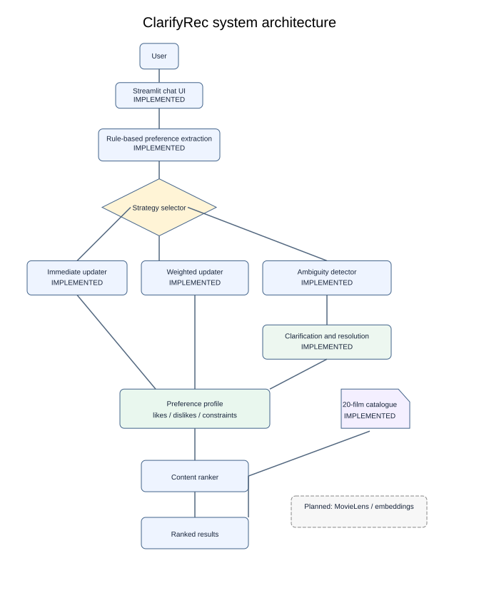
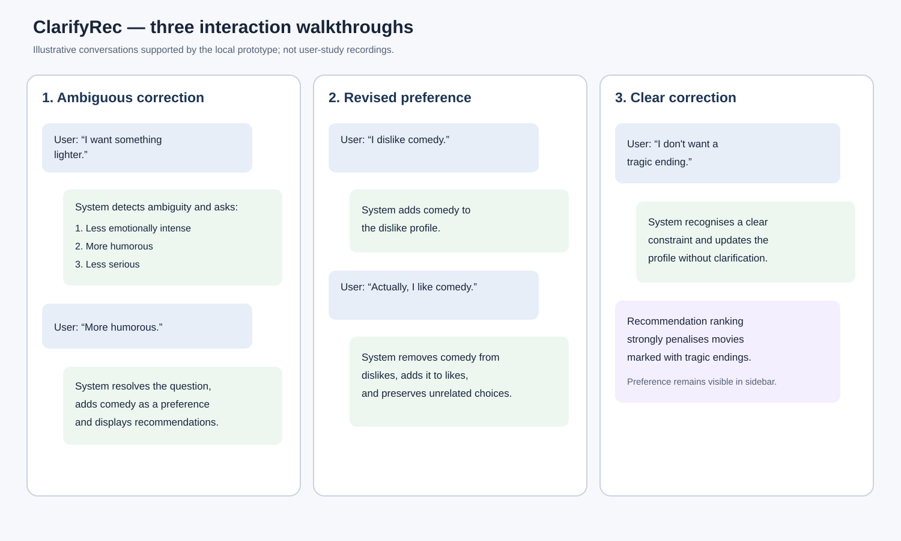

# ClarifyRec: Learning from Natural-Language Corrections in Conversational Recommender Systems

**Abstract word count: 156**  
**Main report word count: 1,076**  
**Total report word count: 1,234 (including the rationale table; excluding title, references, repository links, README, diagrams and captions; whitespace-count estimate).**

## Abstract

Conversational recommender systems must interpret changing user preferences, but short natural-language corrections can be ambiguous or conflict with earlier feedback. This project develops ClarifyRec, a local conversational movie-recommendation prototype that investigates when a system should update preferences immediately and when it should ask for clarification. The application uses a transparent rule-based language component, a structured preference profile and a content-based ranking method over an illustrative 20-film catalogue. It provides three selectable strategies: immediate preference updates, recency-weighted updates and an uncertainty-aware strategy that detects a small set of ambiguous phrases and requests clarification. Eight automated tests pass, covering preference extraction, clarification, revisions and recommendation constraints. The current scope is a reproducible software prototype rather than a validated user study: the language rules and catalogue are limited, and the comparison script uses fixed simulated scenarios. The project therefore demonstrates the interaction and establishes a basis for a later controlled evaluation of recommendation relevance, clarification effort and user experience.

## 1. Project aim and scope

Assignment 1 identified an opportunity to investigate how a conversational recommender should handle ambiguous or revised corrections and decide whether to update a preference or ask a follow-up question. ClarifyRec addresses this question in a movie-recommendation setting. A user might say, “I want something lighter”; the phrase could mean less emotionally intense, more humorous or less serious. Updating the profile without resolving that ambiguity risks turning an uncertain interpretation into a confident preference.

The implemented scope is deliberately bounded. ClarifyRec supports a local Streamlit chat interface, three selectable update strategies, rule-based extraction of a small set of genres and attributes, a structured preference profile, clarification for a small set of ambiguous phrases, and ranked recommendations from a 20-item illustrative catalogue. It requires no paid API or internet connection. It is not a general-purpose language understanding system, does not yet import MovieLens, and has not been evaluated with recruited participants. This bounded scope keeps behaviour inspectable and claims proportionate.

## 2. Design rationale

| Design choice | Why it suits the problem and evidence | Status |
|---|---|---|
| Movie domain and small catalogue | A bounded domain makes preferences such as genre, mood, pacing and ending explicit and enables repeatable scenarios. | Implemented; illustrative data |
| Three selectable strategies | Immediate updates provide a simple baseline; weighted updates represent a critique-weighting comparison; ClarifyRec tests the proposed clarification policy. | Implemented |
| Separate likes, dislikes and constraints | This avoids collapsing “likes romance” and “does not want a tragic ending” into one undifferentiated preference. | Implemented |
| Clarify ambiguous phrases | A targeted question can prevent an uncertain interpretation being stored as fact. This follows the preference-elicitation and partial-observability concerns in Christakopoulou et al. [3] and Wu et al. [4]. | Implemented for a small phrase list |
| Local rule-based NLP | Transparent rules make extraction inspectable and avoid external services, but reduce linguistic coverage. | Implemented |
| Content-based ranking | A transparent scoring function makes the effect of profile changes visible and comparable without introducing a second learned model. | Implemented |
| Semantic model and larger dataset | Embeddings and MovieLens metadata could improve coverage, but would add dependencies and confound the initial comparison. | Planned |

The strategies connect to the reviewed literature. The immediate baseline applies recognised feedback as soon as it is extracted. The weighted baseline adds a recency-related weight, reflecting Luo et al. [1], but is not a reproduction of their latent linear model. The proposed ClarifyRec strategy detects selected ambiguous expressions and pauses updating until the user chooses an interpretation, addressing uncertainty discussed by Wu et al. [4]. Li et al. [2] demonstrate learning critiques from review text without dialogue transcripts; ClarifyRec instead uses inspectable rules and leaves learned semantic interpretation as future work.

ClarifyRec also handles explicit revisions. When a user first dislikes comedy and later says they like comedy, the profile removes the feature from the dislike set and adds it to the like set. Unrelated preferences remain. Clear corrections are treated as revisions, avoiding redundant questions. The system stores explicit ending constraints separately; for example, “I don't want a tragic ending” strongly penalises catalogue entries marked as tragic.

The interaction follows the **recognition rather than recall** principle: users can express preferences in ordinary phrases instead of remembering a fixed command syntax. The sidebar displays the preference profile, supporting **visibility of system status**. Suggested clarification options reduce the effort of formulating a correction. Resetting the conversation and selecting another strategy supports user control and repeatable comparisons. These choices are particularly relevant to critique-based interaction, where the way feedback is solicited can affect the user experience [5].

The local implementation is a conscious compromise. Rule-based phrase matching is predictable and easy to test, but it cannot reliably interpret paraphrases, negation in complex sentences, sarcasm or context beyond its phrase list. The weighted baseline is a heuristic, not a state-of-the-art learning algorithm. The small catalogue demonstrates end-to-end behaviour but cannot establish real-world recommendation quality. A future version could use a larger public dataset and local sentence embeddings, but those extensions are not claimed as completed.

## 3. System architecture and intelligent behaviour

The Streamlit interface sends each user message to the selected strategy. A local extractor identifies recognised preferences, negative cues and a limited set of ambiguous phrases. The immediate and weighted baselines update the profile directly. ClarifyRec checks for a recognised ambiguous phrase; if found, it stores a pending clarification and displays possible interpretations. A subsequent user response resolves the pending state and updates the profile. Clear corrections bypass this step. The shared ranking component scores catalogue entries against positive preferences, negative preferences and explicit constraints, then returns ranked items and match scores.

The architecture diagram marks implemented components and planned extensions. The storyboards show ambiguous, revised and clear corrections. They describe behaviour supported by the current rule-based prototype; they are not evidence from a user study.

## 4. Development and checks

Development proceeded from a small catalogue and profile representation to the immediate baseline, weighted baseline, clarification state and Streamlit interface. Automated tests cover extraction of positive and negative preferences, ambiguity detection, immediate handling of a clear constraint, clarification and resolution, polarity revision, recommendation output from all strategies, and penalties for tragic endings. The current test suite contains eight tests and passes in the local Python environment. The deterministic comparison script replays three fixed scenarios and records clarification prompts and simulated resolutions. These checks establish that selected code paths run, not that ClarifyRec is more accurate or satisfying for real users.

The next evaluation should use identical correction scenarios across all strategies, manually labelled intended preferences and a larger catalogue. Relevant measures include preference interpretation accuracy, NDCG@K or Recall@K, number of turns, unnecessary clarification rate and user satisfaction. A participant study would require approval and recruitment; no performance advantage is claimed yet.

## 5. Repository and development evidence

**GitHub repository:** https://github.com/AnuBReddy/ClarifyRec  
**Submitted commit or release:** See the repository history for the publication commit.  
The README explains setup, project status, dependencies, tests, limitations, AI assistance and the development record. The Mermaid architecture source, storyboards, test suite and comparison script are included in the repository. The prototype and report are published in the linked repository; the publication commit is recorded in GitHub history.

## References

[1] Luo, K., Sanner, S., Wu, G., Li, H. and Yang, H. (2020). “Latent Linear Critiquing for Conversational Recommender Systems.” *Proceedings of The Web Conference 2020*. https://doi.org/10.1145/3366423.3380003

[2] Li, S., Majumder, B. P. and McAuley, J. (2024). “Self-Supervised Bot Play for Transcript-Free Conversational Critiquing with Rationales.” *ACM Transactions on Recommender Systems*. https://doi.org/10.1145/3665502

[3] Christakopoulou, K., Radlinski, F. and Hofmann, K. (2016). “Towards Conversational Recommender Systems.” *Proceedings of the 22nd ACM SIGKDD International Conference on Knowledge Discovery and Data Mining*. https://doi.org/10.1145/2939672.2939746

[4] Wu, Y., Macdonald, C. and Ounis, I. (2021). “Partially Observable Reinforcement Learning for Dialog-based Interactive Recommendation.” *Proceedings of the 15th ACM Conference on Recommender Systems*. https://doi.org/10.1145/3460231.3474256

[5] Cai, W., Jin, Y. and Chen, L. (2022). “Task-Oriented User Evaluation on Critiquing-Based Recommendation Chatbots.” *IEEE Transactions on Human-Machine Systems*. https://doi.org/10.1109/THMS.2021.3131674
